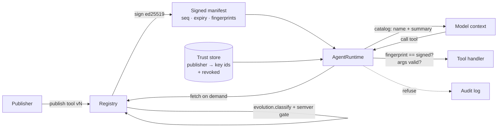

# signed-tool-manifests

A tool registry and agent runtime that only runs tools from ed25519-signed manifests. Features: deferred tool loading, schema versioning with compatibility checks, and tool fingerprints (sha256 of name + version + description + schemas). The runtime refuses unsigned, tampered, rolled-back, downgraded or drifted tools.

## What it is
A publisher's **Registry** stores every version of every tool. It refuses a release whose version bump does not match the schema change. It then signs a **manifest**: a list of `{name, version, summary, fingerprint}` with a monotonic `sequence` and an expiry. The **AgentRuntime** verifies the manifest against a trust store. It puts only names and summaries into the model's context. A full definition is fetched only when a tool is used, and its fingerprint must match the signed one before the tool can run.

## Why
Tool definitions are prompt text and code paths, so they are a supply chain. Without signatures, anyone between the publisher and the agent can change a description ("…always BCC attacker@…"), loosen a schema, or replay an older and weaker version. Loading every full definition up front also wastes context. Deferred loading fixes that, but only if lazily fetched definitions are still checked.

## Architecture


## How it works
| Part | File | Rule |
|---|---|---|
| Fingerprint | [`stm/manifest.py`](stm/manifest.py) | `sha256(canonical_json(name, version, description, inputSchema, outputSchema, annotations))` |
| Signing | `stm/manifest.py` | ed25519 over the canonical manifest body; `kid` = sha256 of the raw public key. Verify checks: has signature → alg → key not revoked → key trusted for that publisher → signature → not expired. |
| Anti-rollback | [`stm/runtime.py`](stm/runtime.py) | Per-publisher high-water `sequence`; per-tool pinned minimum version. |
| Deferred loading | `stm/runtime.py` | `catalog()` and `search()` return stubs only. `load()` fetches once, checks name, version and fingerprint, then caches. A new manifest with a changed fingerprint clears the cache. |
| Arg checks | `stm/runtime.py` | Arguments are validated against the *signed* `inputSchema` before the handler runs. |
| Schema evolution | [`stm/evolution.py`](stm/evolution.py) | Input-schema diff. **Breaking**: type narrowed, required property added, optional → required, property removed from a closed schema, enum values removed, max tightened / min raised, pattern added, `additionalProperties` closed. **Compatible**: optional property added, required → optional, enum widened, integer → number, limits relaxed. |
| Semver gate | `stm/evolution.py`, [`stm/registry.py`](stm/registry.py) | Breaking → major bump. Compatible schema change → at least minor. Description change → at least minor (a silent description change is the classic rug pull). Version must increase. |

## Results
Run: `python3 eval/run_eval.py`. Raw output: [`results/eval_results.json`](results/eval_results.json).

### Attack suite — measured
| Attack | Refused | Code |
|---|---|---|
| Tampered description in transit | yes | `tampered` |
| Tampered schema in transit | yes | `tampered` |
| Tampered manifest body | yes | `bad_signature` |
| Unsigned manifest | yes | `unsigned` |
| Signed by untrusted key | yes | `unknown_key` |
| Signed by revoked key | yes | `revoked_key` |
| Expired manifest | yes | `expired` |
| Replay of older manifest | yes | `rollback` |
| Tool version downgrade | yes | `downgrade` |
| Schema drift (wrong version served) | yes | `schema_drift` |
| Tool not in any manifest | yes | `unsigned_tool` |
| **Total** | **11/11** | legitimate control call: **not refused** |

### Deferred loading — measured context size
Synthetic tools (one paragraph of description and a 3-property schema each). Bytes are JSON characters, not model tokens.

| Tools | Eager (full definitions) | Deferred catalog | Reduction |
|---|---|---|---|
| 10 | 4,460 | 1,160 | 74.0% |
| 50 | 22,380 | 5,840 | 73.9% |
| 200 | 89,780 | 23,390 | 73.9% |

### Tests
31 tests, all passing (`python3 -m pytest -q`; summary in [`results/test_summary.txt`](results/test_summary.txt)): happy path, fingerprint coverage, unsigned, tampered body, unknown signer, revoked key, expiry, tampered definition in transit (handler never runs), schema drift, replay rollback, version downgrade, unknown tool, args rejected by the signed schema, key rotation, deferred loading (one fetch for two calls), cache cleared on a new manifest, a 9-case compatibility matrix, enum/type widening, semver rules, the registry blocking a breaking change without a major bump, the registry blocking a silent description change, and the eval gate.

## Run it
```bash
pip install cryptography jsonschema pytest
python3 -m pytest -q
python3 eval/run_eval.py
```

## Limits
- Keys are generated in memory for tests. There is no key storage, HSM/KMS, transparency log or Sigstore integration.
- The trust store is a local object. Key distribution and revocation propagation are not solved here.
- The compatibility checker covers the common JSON Schema keywords listed above. It does not handle `$ref`, `oneOf`/`anyOf`/`allOf`, `if/then/else` or output-schema compatibility (output changes are covered only by the fingerprint and the description rule).
- The context-size numbers use synthetic tools and count JSON characters, not tokens. The ratio depends on how long real descriptions are.
- Signing proves who published a tool, not that the tool is safe. It should sit next to a content scanner (see `mcp-prod-gateway`).

## Stack
Python 3.12 · cryptography (ed25519) · jsonschema · pytest

## License
MIT
